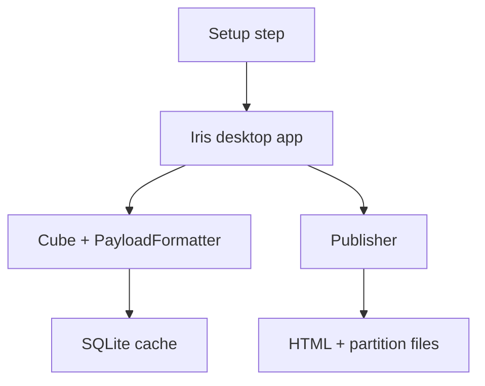

# Iris

**A framework for turning AI-generated HTML dashboards into desktop experiences and publishable web artifacts.**

Iris connects dashboards to data through a desktop app, caches Cube data in SQLite, and publishes HTML with partitioned data files to named environments. The dashboard uses `IrisRuntimeSDK` to read from the desktop WebView bridge or from published files. `Iris(version=...)` labels the application version recorded with each dashboard publication.

[Explore the project example](project-example/src/app.py) · [Browse all documentation](docs/index.md)

## How the pieces connect

## Core concepts

| Concept | What it covers |
| --- | --- |
| [Iris Object](docs/core-concepts/iris-object.md) | Declare a version and register dashboards, data sources, setup steps, and publication environments. |
| [Setup step](docs/core-concepts/setup-step.md) | Collect user inputs and prepare runtime configuration. |
| [Cube](docs/core-concepts/cube.md) | Fetch Polars data and declare its cache schema and partitions. |
| [PayloadFormatter](docs/core-concepts/payload-formatter.md) | Convert Cube data into a dashboard payload. |
| [Cache](docs/core-concepts/cache.md) | Store and manage partitioned data in SQLite. |
| [Desktop app](docs/core-concepts/desktop-app.md) | Navigate dashboards and manage cache and publication. |
| [HTML Runtime](docs/core-concepts/html-runtime.md) | Access data through `IrisRuntimeSDK` in desktop and published modes. |
| [Standalone Builder](docs/core-concepts/standalone-builder.md) | Embed local dashboard assets in one HTML while retaining the SDK CDN script. |
| [Published artifacts](docs/core-concepts/publish-artifact.md) | Understand environments, publication metadata, the web hub, dashboard HTML, and partition files. |
